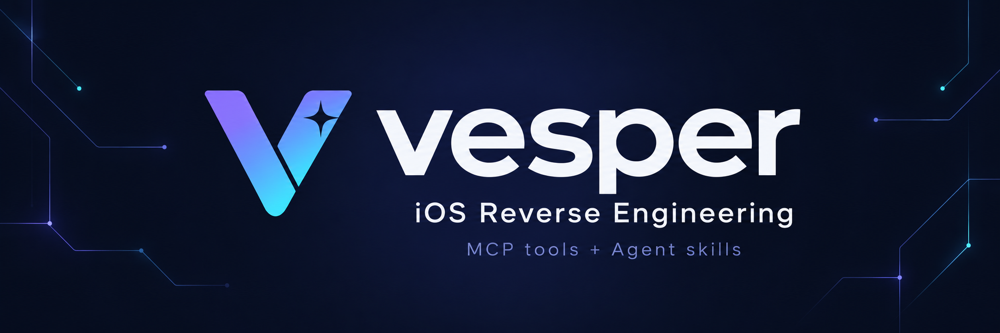
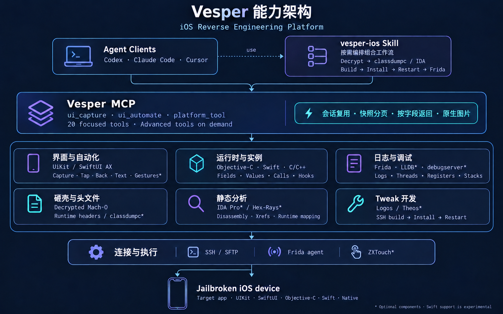

<h1 align="center">
  <a href="docs/assets/vesper-logo.png">
    
  </a>
</h1>

<p align="center">
  <strong>Inspect, automate, analyze and build — from your agent.</strong>
</p>

<p align="center">
  <a href="https://github.com/Wtrwx/vesper/actions/workflows/ci.yml"></a>
  <a href="pyproject.toml"></a>
  <a href="#requirements"></a>
  <a href="LICENSE"></a>
</p>

<p align="center">
  <strong>English</strong> · <a href="README.zh-CN.md">简体中文</a>
</p>

<p align="center">
  <a href="#quick-start">Quick start</a> ·
  <a href="docs/CLIENTS.md">Client setup</a> ·
  <a href="docs/TOOLS.md">Tool reference</a> ·
  <a href="#demos">Demos</a> ·
  <a href="https://github.com/Wtrwx/vesper/issues">Issues</a>
</p>

Vesper is an iOS reverse engineering platform combining structured MCP tools and
agent skills for runtime inspection, app automation, decryption, debugging and
tweak development. Connect your MCP client to SSH, Frida and an optional licensed
IDA installation, then work with the target app through your agent.

The [vesper-ios Agent Skill](skills/vesper-ios/SKILL.md) composes these primitives
into inspection, decryption + classdumpc/IDA, SSH tweak development and debugging
workflows. [Codex, Claude Code and Cursor setup examples](docs/CLIENTS.md) are
included.

| Inspect & automate | Analyze & debug | Build & deploy |
| --- | --- | --- |
| Capture UIKit and exposed SwiftUI accessibility, query live objects and batch UI actions. | Trace Objective-C, inspect Swift/native values, decrypt Mach-O and use optional IDA or LLDB. | Generate editable Logos projects, build with Theos, install and restart over SSH. |

<details>
<summary><strong>Contents</strong></summary>

- [Features](#features)
- [Capability architecture](#capability-architecture)
- [Requirements](#requirements)
- [Quick start](#quick-start)
- [Demos](#demos)
- [Project structure](#project-structure)
- [Development](#development)
- [Security and scope](#security-and-scope)
- [Documentation](#documentation)
- [Contributing](#contributing)
- [Friends](#friends)
- [License](#license)

</details>

## Features

| Area | Capabilities | Example tools |
| --- | --- | --- |
| Devices | SSH/SFTP, device discovery, app and process enumeration | `device_connect`, `device_info`, `device_list_apps` |
| UIKit | Windows and scenes, view trees, hit testing, constraints, responder chains, screenshots | `ui_capture`, `ui_snapshot`, `ui_inspect_view`, `ui_screenshot` |
| Objective-C | Classes, methods, properties, ivars, IMPs, object metadata, generated headers | `objc_dump_class`, `objc_get_methods`, `objc_generate_header` |
| App automation | Batched UIKit/SwiftUI accessibility actions; optional physical gestures over SSH | `ui_automate`, `input_setup` |
| Swift and native | Scoped Swift metadata/values/calls/hooks; selected native fields and C/C++ ABI operations | `swift_runtime`, `runtime_native`, `objc_query_instances` |
| Debugging | Bounded app logs, Frida threads/registers/stacks, optional LLDB locals and component setup | `app_logs`, `debug_inspect`, `debug_setup` |
| Decryption / headers | Reused-session frida-ios-dump, verified Mach-O, actual classdumpc or runtime headers | `app_decrypt`, `objc_dump` |
| Dynamic analysis | Persistent Frida sessions, observation hooks, bounded events and call stacks | `frida_attach`, `frida_trace_method`, `frida_get_events` |
| Static analysis | Optional headless IDA, disassembly, Hex-Rays pseudocode, cross-references, runtime address correlation | `ida_open_binary`, `ida_decompile`, `ida_resolve_runtime_address` |
| Tweak development | Editable Logos projects, ABI validation, Theos builds, direct installation and app restart | `tweak_create_project`, `tweak_build`, `tweak_deploy` |
| Workflows | Button-title tweak workflow, persistent reports, background jobs and cancellation | `develop_tweak`, `job_status`, `job_cancel` |

See the [tool reference](docs/TOOLS.md) for the complete catalog and required fields.

## Capability architecture



Agent skills compose workflows over MCP primitives. SSH and Frida connect those
tools to the target app; classdumpc, IDA/Hex-Rays, LLDB/debugserver, Theos and
ZXTouch provide optional analysis, development and physical-input integrations.
Swift support is experimental. See [automation](docs/AUTOMATION.md) and
[analysis pipelines](docs/DECRYPTION.md) for backend requirements and limits.

## Requirements

| Component | Requirement |
| --- | --- |
| Host | macOS or Linux, Python 3.11+, [uv](https://docs.astral.sh/uv/) |
| Device | An operator-controlled jailbroken iPhone with SSH public-key authentication |
| Frida | Frida 17.x, at least 17.5; the host client and device server must match exactly |
| Tweak builds | [Theos](https://theos.dev/), Logos, `make`, a compatible iOS SDK, compiler/linker and signing tools |
| Tweak deployment | A compatible injection substrate and an SSH account permitted to install packages with `dpkg` |
| Static analysis | Optional licensed IDA Pro 9+ with official `idapro` support and a compatible Python interpreter; Hex-Rays for pseudocode |
| Agent development | Node.js and npm, only when rebuilding the TypeScript agent |

The Python package includes the compiled Frida agent. Basic SSH, UI and runtime
inspection does not require Node.js, Theos or IDA. Rootless jailbreaks are the
primary target. ARM64e tweak builds require an appropriate Apple toolchain on
macOS. SDKs, proprietary tools and device services are supplied by the operator.

## Quick start

### 1. Install the host dependencies

From the repository root:

```sh
uv sync --frozen --all-extras --no-editable
cp -n examples/vesper.toml vesper.local.toml
chmod 600 vesper.local.toml
```

The lockfile provides reproducible Python dependencies. A non-editable install
also works in managed environments that do not load editable `.pth` files.

### 2. Configure your device

Edit `vesper.local.toml`. Set an absolute workspace path, the SSH endpoint,
your key, verified SSH host keys, allowed app bundle IDs and the Frida transport.

```toml
workspace = "/absolute/path/to/vesper"
state_dir = ".vesper"

[devices.test]
host = "127.0.0.1"
port = 2222
username = "root"
client_keys = ["~/.ssh/id_ed25519"]
known_hosts = "~/.ssh/known_hosts"
allowed_apps = ["dev.iosdecompiler.fixture"]
frida_device_id = "replace-with-observed-device-id"
```

The example endpoint assumes an existing local SSH forward; use your device's
actual endpoint. Verify and pin the SSH host key before connecting. Select the
exact device ID returned by `frida_list_devices`. For an existing secured
Frida SSH tunnel, replace `frida_device_id` with
`frida_remote = "127.0.0.1:27043"`; configure one transport per device.

Select a config with `--config` or the `VESPER_CONFIG` environment
variable. `--config` takes precedence. State defaults to `.vesper`
under the workspace.

For tweak builds, set `THEOS` or the config's `theos` path. For IDA, configure
`ida_directory` and `ida_python` after completing the vendor's normal licensing
and Python setup. See the comments in the [example config](examples/vesper.toml).

### 3. Connect an MCP client

```sh
.venv/bin/vesper --config /absolute/path/to/vesper/vesper.local.toml
```

Configure your MCP client to launch this command with absolute paths. Stdout
carries the MCP protocol; diagnostics go to stderr. See [client setup](docs/CLIENTS.md)
for Codex, Claude Code and Cursor examples.

The default `tool_profile="focused"` advertises 20 common tools. Advanced
primitives remain available through `platform_tool`: request one schema with
`action="schema"`, then call it with `arguments`. `tool_profile="full"` advertises
all 74 primitives. Copy `skills/vesper-ios` into your agent skill directory
(for Codex, `~/.codex/skills/vesper-ios`) to load workflows on demand.

Structured results are returned once in `structuredContent`, with a short text
status. For clients that only consume text, set `legacy_text_json = true` to
restore the duplicate JSON text. Images always use native image content.

Idle sessions are reclaimed after 300 seconds by default; pending operations,
hooks and running workflows protect them. Set `session_idle_timeout = 0` to
disable this. `ssh_probe_ttl`, `snapshot_ttl`, `snapshot_max_count`,
`snapshot_max_bytes`, `object_handle_ttl` and `maintenance_interval` are configurable
in the top-level TOML settings. `device_info(force_refresh=true)` bypasses the SSH
probe cache; connection failures/reconnections invalidate it automatically.
`screenshot_transport = "binary"` avoids base64 on the Frida link while preserving
the original PNG/scale. Use `"base64"` for transport compatibility. MCP image
content remains native in either mode.

Run one server per state directory. A config without devices supports host-only
tools such as `server_status`. The server itself does not require a model API key.

Optional header dumping uses host `classdumpc` (PATH or the `classdumpc` setting).
Optional stopped inspection needs host LLDB and device debugserver; `debug_setup`
checks components and installs missing debugserver from local Apple iOS support.
See [decryption and analysis pipelines](docs/DECRYPTION.md) for runtime and offline workflows.

## Demos

### Capture an app in one call

Open an allowlisted app on the unlocked phone, then call `ui_capture`:

```json
{"device_id":"test","bundle_id":"dev.iosdecompiler.fixture","mode":"summary","include_text":false}
```

`mode` is required: `summary` returns visible controls (including custom touch or
gesture views), `screenshot` returns a native MCP PNG image and `local_path`, and
`both` returns both. Text still requires `include_text: true`. A valid session is
reused; cold capture probes SSH and verifies the running app before attaching.
Consecutive captures are live; they do not enumerate apps or attach again while
the same verified process session remains valid. No app launch/restart is implicit.

Summary defaults to IDs, classes, frames, interaction flags and parent/depth
links. `format: "detail"`, `fields`, `visible_only: false` and
`controls_only: false` opt into more data. Controllers, targets and constraints
are fetched only when requested. Visibility includes hidden/transparent ancestors
and window intersection; occlusion by other views is not inferred.

The summary contains `session_id` at the capture root and `snapshot_id`,
`captured_at`, `truncated` and `next_cursor` inside `summary`. Pass the session ID
and the cursor to `ui_snapshot` to read the next immutable page without accessing
the device. `ui_find_views` uses the same paging model. Omit `snapshot_id` to
collect the current UI again; collection/filter options cannot change on a cached
page. Default retention is 60 seconds, 4 captures and 8 MiB globally, with earlier
eviction possible under the 2048-object device bound.

### Automate the app and read instance values

`ui_automate` reuses/attaches the verified app session and runs up to 20 actions in
one MCP call (one Frida RPC for a semantic batch). Supported actions include `tap`, `back`, `input_text`,
`scroll`, `assert`, `wait_for` and semantic `accessibility` operations. Targets accept a leased `view_id`, a unique
identifier/class/text selector, or window coordinates in UIKit points.

```json
{"device_id":"test","bundle_id":"dev.iosdecompiler.fixture","steps":[{"action":"tap","target":{"accessibility_identifier":"fixture.button"}},{"action":"assert","target":{"accessibility_identifier":"fixture.status","text":"Tapped"}}],"after_capture":"summary"}
```

Failed steps stop the batch; mutations
are never retried automatically. Waiting is opt-in and bounded to 10 seconds per
batch. Post-capture defaults to `none`; text and PNGs remain explicit.

Tap dispatches UIKit control events or accessibility activation. Back pops a
navigation controller or dismisses a modal; scroll adjusts UIScrollView offsets;
input sets UITextField/UITextView text and emits change events. These semantics
cover app testing without additional device services. Physical gestures use the optional
SSH input backend described below. See
[automation and value queries](docs/AUTOMATION.md) for examples and limits.
Paged feeds accept `scroll` with `pages: 1` or `pages: -1`; distance comes from
the current scroll viewport on-device. Reuse its observed view ID and opt into
`animated: true`/`settle_ms` when the app needs animation before checking state.

`objc_query_instances` combines attach/reuse, bounded heap discovery and concrete
ivar values. Select fields to keep results small:

```json
{"device_id":"test","bundle_id":"dev.iosdecompiler.fixture","class_name":"DecompilerFixtureViewController","field_names":["_tapCount","_button"],"max_instances":5,"limit":5}
```

Use `object_ids` instead of `class_name` to read already leased objects, including
different classes, without scanning the heap. Pages use the returned
`snapshot_id` and never revisit the device. Default reads cover at most 8 ivars,
20 instances, 10 rows per page, bounded Foundation values and redacted sensitive
fields. This Objective-C query invokes no arbitrary getter or `description`. Pure Swift
and explicitly typed native operations use their own advanced tools below.

### SwiftUI, pure Swift and native operations

`ui_capture` defaults to `backend="auto"`: UIKit summaries gain public SwiftUI
accessibility-container nodes when exposed. `backend="accessibility"` selects
that semantic tree. Its leased IDs share the existing snapshot cache and work
with `ui_automate` tap or `action="accessibility"` operations: activate, increment,
decrement, escape and scroll. Text remains opt-in. This does not reconstruct the
SwiftUI internal view/state graph or enable VoiceOver globally.

Advanced tools remain behind `platform_tool`; focused discovery stays at 20 tools.

| Tool | Use |
| --- | --- |
| `swift_runtime` | Runtime capabilities; bounded type metadata in selected Mach-O `images`; selected instance getter values; explicitly typed Swift calls and argument traces; ARC release/reset |
| `runtime_native` | Filtered symbols in one module; fields at known offsets; bounded explicit memory read/write; C ABI calls; integer/pointer argument and return traces |
| `input_setup` | Check/install the optional external ZXTouch component from a matching local deb; explicit `activate=true` restarts SpringBoard |

```json
{"name":"swift_runtime","arguments":{"device_id":"test","bundle_id":"dev.fixture","action":"types","images":["MyFramework"],"kind":"classes","query":"Player","limit":5}}
```

The official **frida-swift-bridge 3.0.2** is experimental. Vesper patches its
import-time whole-process scan into lazy image-scoped discovery with a type budget
(default 1000); default scope is the main executable and libswiftCore. Capability
queries do not load the bridge. It reuses the native Frida session, caches metadata,
and can reset independently. `inspect(kind="class", address=…, field_names=[…])`
executes only explicitly requested getters. Retained class handles use Swift ARC,
expire with the configured object TTL, and are capped at 128; active calls protect
inputs. Struct/enum storage is borrowed; scalar values/tag summaries need no deep
copy or retained handle. Generic, async, stripped and floating-point signatures
can remain unsupported. There is no automatic pure-Swift heap scan.

Native calls require a known C ABI signature; C++ member calls require an explicit
`this` pointer. Read selected fields with known offsets from IDA/debugger evidence.
Return pointers and temporary C strings are borrowed. Do not guess an ABI.

`swipe`, `long_press` and `gesture` (1–5 finger paths for pinch/rotation/custom
motion) route through optional ZXTouch over an SSH loopback channel. Set
`input_backend="touch"` for physical tap/text/scroll. Raw coordinates use oriented
**screen UIKit points** and need no Frida attach when no observation is requested.
Screen size/scale are cached per SSH connection; orientation stays fresh. Cancellation
attempts finger-up cleanup. A service acknowledgement confirms processing, not
application behavior. The default UIKit/accessibility route needs no new service.
ZXTouch is external, not bundled; `input_setup` returns actionable installation
hints when unavailable. No VNC is required. See the on-demand
[Swift/native/input skill guide](skills/vesper-ios/references/swift-native-input.md).

### Inspect using the lower-level tools

Open an allowlisted app on the unlocked phone. Call `device_connect` and
`device_list_apps` with `{"device_id":"test"}`, then call `frida_attach`:

```json
{
  "device_id": "test",
  "bundle_id": "dev.iosdecompiler.fixture"
}
```

Use the returned `session_id` in `ui_snapshot`:

```json
{
  "device_id": "test",
  "session_id": "process_SESSION_ID",
  "depth": 8,
  "max_nodes": 500,
  "limit": 100,
  "include_text": false
}
```

Replace placeholder IDs with observed values. Use `ui_inspect_view` to inspect a
returned view's controller and target-action mappings. Request text explicitly
with `include_text: true` when needed. Call `frida_detach` when finished.
Object IDs remain valid while a live snapshot or operation lease references them.
They can expire or be evicted; reacquire them with a live capture. Session IDs
also become invalid after idle reclamation, detach, process exit or restart.

### Capture the current app window

After attaching, call `ui_screenshot`:

```json
{
  "device_id": "test",
  "session_id": "process_SESSION_ID"
}
```

The tool renders the attached application's UIKit window to PNG, using the key
window by default. To select another window, pass a `window_id` returned by
`ui_get_windows`. It returns a native MCP image block plus structured metadata
including `mime_type`, `local_path`, `bytes` and `window_id`. MCP clients with
image support can display the image directly.

Images are saved under `<state_dir>/screenshots/`. Capture is limited to the
selected application's renderable window; system overlays and some protected
or GPU-rendered content may be absent.

### Build and install a button-title tweak

The [UIKit fixture](examples/UIKitFixture/README.md) provides a button with
accessibility identifier `fixture.button` and an Objective-C action. Build,
install and launch the fixture using that guide, then call `develop_tweak`:

```json
{
  "device_id": "test",
  "bundle_id": "dev.iosdecompiler.fixture",
  "accessibility_identifier": "fixture.button",
  "replacement_title": "Hello vesper"
}
```

The workflow inspects the button, validates an observed controller lifecycle
method, generates an editable Logos project and builds a package. It requires a
unique matching `UIButton` and a supported method signature. Jobs run in the
background by default; retrieve the report using `job_status` and the returned
`job_id`.

At the approval stage, an operator reviews the exact operation in a separate
terminal. Use the report's approval ID and the server's absolute state directory:

```sh
.venv/bin/vesper-approve --state-dir /absolute/path/to/vesper/.vesper approval_ID
```

Resume `develop_tweak` with `workflow_id` and the granted `approval_id`.
After installation succeeds, restart through SSH with `app_restart` (already
included by `restart=true`) and use Frida/`ui_automate` to exercise the requested
change. Do not create backups, add local/smoke/long regression tests, or compare
loaded modules, build markers, UUIDs or installed-file hashes. Inspect installation
identity or crash reports only when diagnosing a relevant failure. Stop on the
first important failure and fix it before continuing.

Complete supported build/install/restart/UI operations yourself. No VNC service
is needed. After user acceptance, finish the authorized commit/push without
adding more checks or repeatedly polling CI.

## Project structure

```text
vesper/
├── src/vesper/
│   ├── server.py        # MCP stdio entry point
│   ├── config.py        # Validated configuration
│   ├── core/            # Sessions, state, approvals, jobs and evidence
│   ├── adapters/        # SSH, Frida, IDA, Mach-O and Theos integrations
│   ├── tools/           # Structured MCP tools
│   ├── workflows/       # Tweak development and deployment
│   └── assets/          # Bundled Frida agent and license notices
├── agents/frida/        # Device-side TypeScript source
├── examples/            # Configuration, UIKit fixture and demo
├── scripts/             # Build and documentation utilities
├── tests/
├── docs/
├── pyproject.toml
└── uv.lock
```

## Development

For app/tweak work, use this default flow:

**Locate the issue → smallest change → build → install → focused device check → authorized commit/push.**

Do not create backups or add local test suites, smoke tests, long regressions,
sampling campaigns or test reports to that flow. Reuse what has already been
read; inspect relevant differences instead of rereading entire files. Read only
the target controls and capture an image when reproducing a visual issue,
checking its fix, or diagnosing an exception. Do not continue checking after
acceptance without a new change, failure or user request.

For Vesper code changes, use only the smallest relevant existing test. The
lightweight CI builds the package and runs the deployment/restart tests once.

After changing Python source, update the installed MCP directly:

```sh
uv sync --frozen --all-extras --no-editable --reinstall-package vesper
```

Rebuild the bundled agent with `npm ci --ignore-scripts && npm run build` only
when its TypeScript source changes. Generate tool documentation with
`PYTHONPATH=src .venv/bin/python scripts/document_tools.py`.

## Security and scope

- Device and application allowlists constrain targets. Routine inspection is the default; installation, app restarts and other disruptive operations require local approval.
- Approvals bind exact operation arguments and artifacts, expire, and can be consumed once. MCP clients cannot grant their own approvals.
- Tools expose bounded operations with structured errors, audit records and cleanup. Arbitrary shell commands and injected JavaScript are not exposed through MCP.
- UIKit operations, object retain/release and PNG encoding run on the main queue. Object leases expire or are evicted within the existing 2048-object bound; shared and executing operation references remain protected.
- UIKit/Objective-C, exposed SwiftUI accessibility, scoped experimental Swift and explicit native ABI operations use separate backends. Complete Swift metadata/SwiftUI reconstruction and all generic/async signatures are not guaranteed.
- Runtime/static address correlation requires matching image identity, architecture and segment evidence. Inferred types and pseudocode are labeled accordingly.

Keep local configs, keys, state databases, traces and screenshots private. See
[security and recovery](docs/SECURITY.md) for approval and rollback behavior.

## Documentation

| Guide | Description |
| --- | --- |
| [Client setup](docs/CLIENTS.md) | Connect MCP clients over stdio |
| [Tool reference](docs/TOOLS.md) | Tool groups, required inputs and behavior |
| [Automation and value queries](docs/AUTOMATION.md) | UIKit/SwiftUI actions, instance values and input backends |
| [Decryption and analysis](docs/DECRYPTION.md) | Mach-O extraction, headers and optional static analysis |
| [Agent skill](skills/vesper-ios/SKILL.md) | On-demand workflows for inspection, analysis, debugging and tweaks |
| [UIKit fixture](examples/UIKitFixture/README.md) | Build the example app and run the complete demo |
| [Security and recovery](docs/SECURITY.md) | Permissions, approval scopes and failure recovery |
| [Troubleshooting](docs/TROUBLESHOOTING.md) | Device, Frida, IDA and build diagnostics |
| [Upstream review](docs/EXISTING_PROJECTS.md) | Reuse decisions, compatibility and licensing |
| [Third-party notices](THIRD_PARTY_NOTICES.md) | Bundled and external dependency licenses |

## Contributing

Issues and pull requests are welcome. Include the relevant host, iOS, jailbreak,
Frida and toolchain versions when reporting a problem, with sensitive data
removed. Keep changes focused, use minimal relevant checks, and update both READMEs
when changing user-facing behavior. Add new tools to the generated reference.

## Friends

- [LINUX DO](https://linux.do/)

## License

Original vesper code is available under the [MIT License](LICENSE). Bundled
code and dependencies retain their own licenses; see [third-party notices](THIRD_PARTY_NOTICES.md).

Built with [Frida](https://frida.re/), [Theos](https://theos.dev/) and the
[MCP Python SDK](https://github.com/modelcontextprotocol/python-sdk), with
inspection concepts inspired by [FLEX](https://github.com/FLEXTool/FLEX).
